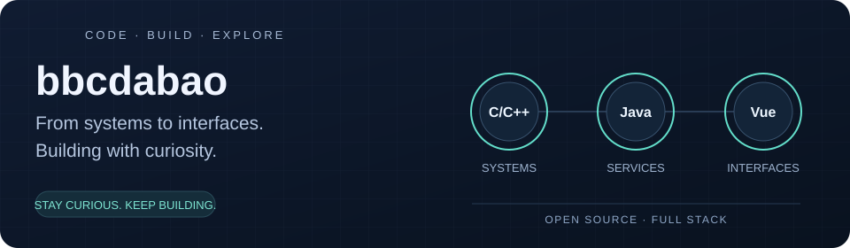

# 你好，我是 bbcdabao 👋

**全栈开发者 · 开源爱好者 · 曾就职于中兴（ZTE）**

从 C/C++ 嵌入式与服务端开发，到 Java 后端和 Vue 前端，我喜欢把系统从底层逻辑一路做到用户界面。现在专注于独立开发和个人开源项目，围绕可复用组件、分布式网络拨测和小型应用的公共底座持续实践。

🏍️ 键盘之外，我也是一名摩托车骑行爱好者。

[English](README.md) · **简体中文**

## 🐍 代码之外，来一局？

[游戏页面与打开方式](game/README.md) · [在线试玩（启用 GitHub Pages 后可用）](https://bbcdabao.github.io/bbcdabao/game/)

## 我做项目的几个特点

- **跨层思考，也动手落地。** 做过嵌入式、后端服务和 Web 界面，习惯把各个环节连起来看，关心它们如何协同工作。
- **喜欢把经验沉淀成可复用的东西。** 从 Spring Boot 组件，到统一的账号与权限管理，希望每一次积累都能让下一个项目更容易起步。
- **用代码探索问题。** 把想法写成项目和示例，尤其关注分布式协调、架构扩展性，以及系统如何稳定运行。

## 从这些项目认识我

### [BaoSys](https://github.com/bbcdabao/baosys) — 给小型应用搭一个公共底座

面向个人开发者和小团队的多子系统平台底座。通过 Manager 统一管理账号、登录、权限和会话，各个业务系统保留自己的界面与业务逻辑，减少重复搭建基础功能的工作。

**可以重点看看：** 共享登录流程、网关与接口授权、会话撤销，以及模块职责的划分。

`Java 17` · `Spring Boot` · `Spring Cloud Gateway` · `PostgreSQL` · `Vue 3` · `TypeScript`

### [ping-monitor](https://github.com/bbcdabao/ping-monitor) — 让分布式拨测协同工作

基于 ZooKeeper 的分布式网络拨测系统，协调拨测节点、分配任务，并在 Web 控制台展示结果。通过插件机制扩展拨测方式，把不同的探测能力接入同一套系统。

**可以重点看看：** 节点注册、分布式协调、插件模板，以及通过 SSE 实时推送拨测结果。

`Java` · `Spring Boot` · `ZooKeeper` · `Vue 3` · `TypeScript`

*项目进度：仓库文档记录了 Ping、DNS、TCP 三类拨测组件的自测；Prometheus exporter 仍在开发中。*

### [componentsbrz](https://github.com/bbcdabao/componentsbrz) — 我的组件实验场

把 Spring Boot 组件和使用示例放在一起，方便边看边理解。可以从 WebSocket 组件入手，再看看基于它实现的远程 SSH 终端和聊天室。

**可以重点看看：** 一个通用组件如何被组合成实际应用。

`Java` · `Spring Boot` · `WebSocket` · `Node.js`

## 常用技术

| 方向 | 技术 |
| --- | --- |
| 后端与系统开发 | Java、Spring Boot、C、C++、Node.js |
| 前端开发 | Vue 3、TypeScript、HTML、CSS |
| 数据与分布式协调 | PostgreSQL、MySQL、Redis、ZooKeeper、Kafka |
| 工程工具 | Git、Docker、Maven、Vite |

## 一起交流

如果你也在做 Java/Vue 全栈开发、分布式系统或可复用组件，欢迎交流想法。项目中的问题、建议和贡献，也都欢迎。

📬 [baobao.minghui@gmail.com](mailto:baobao.minghui@gmail.com)

感谢来访，挑一个感兴趣的项目逛逛吧！
