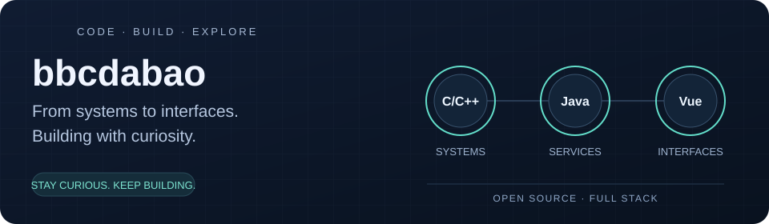

# Hi, I'm bbcdabao 👋

**Full-stack developer · Open-source enthusiast · Formerly at ZTE**

From C/C++ on embedded devices and servers to Java services and Vue interfaces, I enjoy building systems end to end. These days, I focus on independent development and personal open-source projects: reusable components, distributed network probing, and shared foundations for small applications.

🏍️ Away from the keyboard, I'm a motorcycle enthusiast.

**English** · [简体中文](README-CH.md)

## 🐍 Take a little break

[Game page & setup](game/README.md) · [Play after GitHub Pages is enabled](https://bbcdabao.github.io/bbcdabao/game/)

## What I bring to my projects

- **A view across the stack.** My experience spans embedded development, backend services, and web interfaces. I like understanding how the pieces work together.
- **An eye for reusable building blocks.** From Spring Boot components to shared account and permission management, I look for foundations that make the next project easier to build.
- **Hands-on exploration.** I turn ideas into code and examples, with particular interests in distributed coordination, extensible architectures, and reliable systems.

## Explore my work

### [BaoSys](https://github.com/bbcdabao/baosys) — a shared foundation for small applications

A platform foundation for independent developers and small teams working on multiple applications. Its Manager system centralizes accounts, login, permissions, and sessions, while business applications keep their own interfaces and logic.

**Worth exploring:** shared login flows, gateway and API authorization, session revocation, and clear module boundaries.

`Java 17` · `Spring Boot` · `Spring Cloud Gateway` · `PostgreSQL` · `Vue 3` · `TypeScript`

### [ping-monitor](https://github.com/bbcdabao/ping-monitor) — distributed network probing

A ZooKeeper-based system that coordinates probing workers, distributes tasks, and displays results in a web console. A plugin mechanism makes it possible to add new probe types.

**Worth exploring:** worker registration, distributed coordination, plugin templates, and live results delivered through SSE.

`Java` · `Spring Boot` · `ZooKeeper` · `Vue 3` · `TypeScript`

*Project status: the README reports self-testing for Ping, DNS, and TCP probes; the Prometheus exporter is still under development.*

### [componentsbrz](https://github.com/bbcdabao/componentsbrz) — my component playground

A collection of Spring Boot components and examples that show how to use them. Start with the WebSocket component and its remote SSH terminal and chatroom examples.

**Worth exploring:** how a reusable component becomes a working application.

`Java` · `Spring Boot` · `WebSocket` · `Node.js`

## My toolkit

| Area | Technologies |
| --- | --- |
| Backend & systems | Java, Spring Boot, C, C++, Node.js |
| Frontend | Vue 3, TypeScript, HTML, CSS |
| Data & coordination | PostgreSQL, MySQL, Redis, ZooKeeper, Kafka |
| Engineering tools | Git, Docker, Maven, Vite |

## Let's connect

Interested in Java/Vue development, distributed systems, or reusable components? I'd be happy to exchange ideas. Questions, issues, and contributions to my projects are welcome.

📬 [baobao.minghui@gmail.com](mailto:baobao.minghui@gmail.com)

Thanks for stopping by — pick a project above and take a look around!
